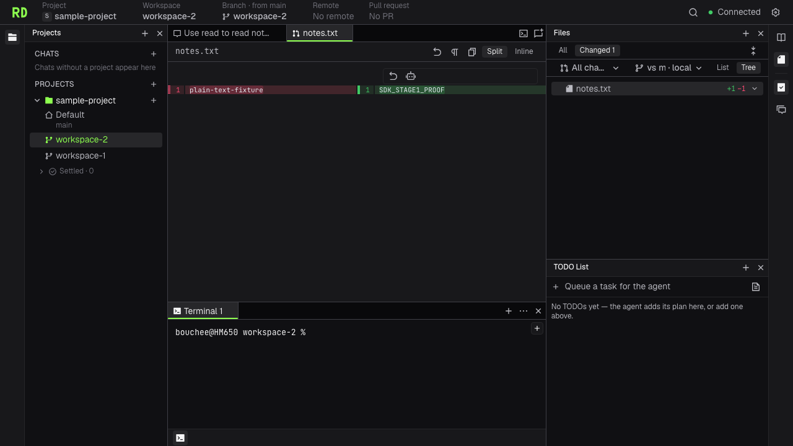

# RailDesign

RailDesign is a fork of ThinkRail's agent workbench with an OpenAI Agents SDK execution kernel.
It keeps the project/worktree navigation, Monaco editor, file tree, Diff, terminal, themes and localization.
The development build connects agent tasks to selected worktrees, with file edits, bounded commands,
streaming output, tool approval and Stop. Sessions save conversation history, input queues and pending
approvals or questions. Steering reaches the next eligible model call; follow-ups wait for normal task
completion. Pending input stays visible until admission succeeds.

Restart restores saved conversations and pending interactions. Interrupted side effects are marked
unknown and require a new user decision. `/compact` summarizes model memory while retaining the full
conversation for display and search. Automatic summaries use the selected verified model's context
budget; summary failures preserve the previous memory.

Advanced tools, desktop releases and private-server deployment have separate implementation and
acceptance stages. Controls for unavailable tools remain disabled. This source checkout does not
establish a released installer or cross-platform acceptance.



## Develop locally

Use the Bun version pinned in `package.json` and Git on the host.

```bash
git clone https://github.com/Bouchee/thinkrail.git
cd thinkrail
bun install
bun run dev
```

Configure a verified Responses-compatible endpoint and its model in the app's Custom endpoints settings,
or provide `OPENAI_BASE_URL`, `OPENAI_MODEL` and `OPENAI_API_KEY` to the host. The base URL ends before
`/responses`. The stage 0 verified target is OpenCode Go:

```text
OPENAI_BASE_URL=https://opencode.ai/inference/go/openai/v1
OPENAI_MODEL=deepseek-v4.1-flash
```

Keep the API key in protected host configuration. Do not commit it or include it in browser assets.
Listing a model through `/models` does not prove Responses or tool support.

The CLI is `raildesign`; `--no-open` starts the same host without opening a browser.
CLI and desktop entries share one execution path. The host, its Git commands and agent tools act on the
same selected worktree; the displayed Diff comes from the actual files.

## Identity and local data

RailDesign's application identifier is `io.github.bouchee.raildesign`. Its default state directory is
`~/.raildesign`; CLI installation metadata and cache use `raildesign` directories. It starts with fresh
records and does not import official ThinkRail or pi sessions, credentials or plugins.
Sessions use format 2. Earlier-format files remain on disk and are not migrated.

Updates are configured only for [this fork's releases](https://github.com/Bouchee/thinkrail/releases),
with the desktop channel under `releases/download/desktop-updates`. Signing, installation and an actual
update between releases remain separate release gates.

JetBrains service integrations, telemetry, attribution and surveys are removed. Local SDK tracing starts
disabled and can be enabled in chat settings. Traces are not exported to OpenAI. Existing font family
names and upstream license notices remain as required.

## Verify

Run focused tests while developing. Before handing off app changes, run the repository dependency,
boundary, lint and typecheck gates and the complete no-agent browser suite once. Changed agent behavior
also needs an isolated focused live check. The full live suite requires explicit approval.

```bash
bun run check:deps
bun run check:boundaries
bun run lint
bun run typecheck
bun run test
bun run e2e
```

[Product scope](goal-and-requirements.md), [architecture](architecture.md) and each module's `SPEC.md`
define the contracts. Preserve the [upstream license](LICENSE) and attribution notices.
